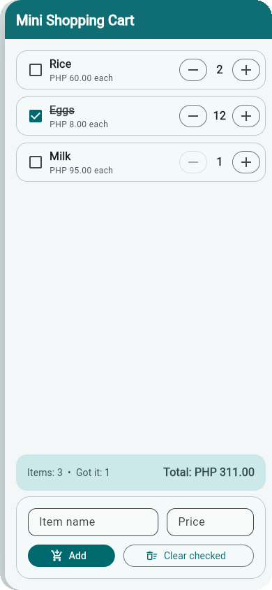

# Laboratory Activity No. 3 — Mini Shopping Cart with `StatefulWidget`

**Name:** Jay Camacho

**Activity:** Building a Mini Shopping Cart with `StatefulWidget`

**Topic:** Flutter Widgets — `StatefulWidget` and `setState()`

A one-screen Flutter shopping cart built for Laboratory Activity No. 3. The
screen is a `StatefulWidget` (`CartScreen` + `_CartScreenState`) that owns the
`List<CartItem>`. The stateless `CartItemTile` receives an item plus
`onIncrease`, `onDecrease`, and `onToggle` callbacks, so every data change
happens in the parent's `setState()`.



## Features

- `CartItem` model with `name`, `price`, changeable `quantity` and `gotIt`.
- `initState()` preloads the three sample items: Rice (PHP 60.00 × 2),
  Eggs (PHP 8.00 × 12, already checked), and Milk (PHP 95.00 × 1).
- Quantity controls that never go below 1 or above 99.
- "Got it" checkbox that strikes through the item name.
- Live summary bar with **Items**, **Got it**, and **Total: PHP X.XX**.
- Add-item form with validation: the name cannot be empty and the price must be
  a number greater than 0. Valid items are added and both fields are cleared.
- **Clear checked** removes every item marked as got it.
- `dispose()` releases both `TextEditingController`s.

## Run the app

```bash
flutter pub get
flutter run -d chrome
```

You can also run it on Windows, an Android emulator, or a physical device.

## Tests

```bash
flutter test
```

The widget tests cover the preloaded items, live total updates, quantity limits,
form validation, adding an item, and clearing checked items.

## Project structure

```text
lib/main.dart              # CartItem, CartScreen, CartItemTile
test/cart_screen_test.dart # Widget tests
screenshots/app.png        # App screenshot
```
